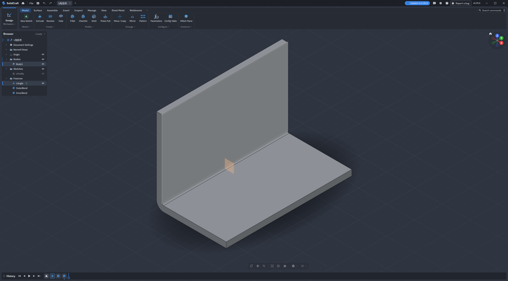

# SolidCraft DSH 建模助手

一个 [DeepSeek Harness](https://github.com/deepseek-ai/deepseek-harness)（DSH）Agent 预设：通过中文对话驱动 [SolidCraft](https://docs.solidcraft.io/) 做参数化建模——建参数、画草图、做特征、验证尺寸、出图，并按 SolidCraft 官方规范整理 bug 报告。



## 特性

- **对话即建模**：接入 SolidCraft 的 [MCP 服务器](https://docs.solidcraft.io/guide/mcp.html)，20 个原生工具（`batch`、`execute`、`measure`、`body_topology`、`check_parameters`、`screenshot`、`export`、`save`、`skill_reference`…）。
- **参数化优先**：所有尺寸/位置由用户参数驱动，草图要求全约束，特征命名，先外后内。
- **数字验证**：每阶段用 `measure` 对照手算体积/包围盒；`ok: true` 不算成功（切不到材料的 cut 也会成功）。
- **专属技能**：`solidcraft-assistant` 技能覆盖会话流程、参数化规则、验证标准、交付格式和 GUI 预览。
- **Bug 报告规范**：按 SolidCraft 官方的 `solidcraft-reporting` 流程：全新设计最小复现 → 缩小脚本 → 数字核对 → 搜索已有 issue → 用户同意后才提交。
- **GUI 预览**：自动发现并复用已运行的 SolidCraft 实例；同一模型修改后**更新原 tab**，只有新模型才新开 tab；绝不反复关闭/重启窗口。
- **设计任务书（brief）**：Host 工具 `brief` 提供 `init / read / update`，在项目根维护 `brief.json`（schema、revision、参数、需求、产物路径）；开始建模前先立任务书。
- **工程计算（calc）**：Host 工具 `calc` 支持带单位的表达式（mm/cm/m/in/ft、deg/rad、g/kg、s），白名单解析，无 `eval`；返回数值、单位、量纲与展示文本。
- **报告检查（report_check）**：Host 工具 `report_check` 检查报告结构（结论/假设/计算/校核/未决）、口语化/伪专业措辞、无单位数值、标准引用是否带版本；错误阻断，警告提示。
- **作用域隔离**：MCP 工具只在“Solidcraft 建模助手”预设内注册，其它会话看不到。

## 环境要求

- SolidCraft **0.29+**（`solidcraft`、`solidcraft-cli` 在 `PATH` 中）
- DSH（测试于 `0.2.1-rc.5`）
- Python **3.10+**（预览脚本、验证脚本）
- 桌面环境；GUI 预览在 Linux + systemd user manager 下最稳（无 systemd 时脚本会退回普通进程启动）
- 操作系统：Linux（已在 X11 下实测）；macOS/Windows 可建模与出图，GUI 预览脚本中的 systemd 路径不适用

## 安装

不需要先 clone，DSH 可以直接从 GitHub 安装这个 bundle。

### 用 Creator 预设安装（推荐）

1. 在 DSH Web 新建任务，Agent 预设选 **Creator**；
2. 对它说：

   ```text
   安装 bundle：plugin_manager install_bundle github:Songian/solidcraft-assistant-dsh#path:/solidcraft-assistant
   ```

3. 安装完成后，新建任务时就能选 **“Solidcraft 建模助手”**。

### 手动安装

```sh
dsh plugin --profile web add "github:Songian/solidcraft-assistant-dsh#path:/solidcraft-assistant"
```

再把 `@local/solidcraft-assistant` 加进该 profile `package.json` 的 `dsh.profile.bundles`，重启 `dsh web`。如果 pnpm 报 `ERR_PNPM_ADDING_TO_ROOT`，在 profile 目录新建 `.npmrc` 写入 `ignore-workspace-root-check=true`。

如果访问 `github.com` 的 HTTPS 超时（TLS 被代理/网络拦截），改用 SSH 规格安装，pnpm 会把它记录为 `github:`：

```sh
dsh plugin --profile web add "git+ssh://git@github.com/Songian/solidcraft-assistant-dsh.git#path:/solidcraft-assistant"
```

或在 Creator 里执行：

```text
plugin_manager install_bundle git+ssh://git@github.com/Songian/solidcraft-assistant-dsh.git#path:/solidcraft-assistant
```

权限：默认使用 `--allow-any-path`，助手可以读写应用能访问的任意路径，`designs/`、`renders/` 建在当前工作目录即可。要收紧权限，把 `cordis.patch.yml` 里的 `--allow-any-path` 换成 `--allow-path <目录>`，并让 `designs/`、`renders/` 位于该目录内。

## 使用

新建任务，预设选 **“Solidcraft 建模助手”**，然后直接说需求：

- “做一块 120×80×6 的安装板，四角 R5，四角各一个 M3 沉头孔，孔边距 8 mm，做成可改尺寸的。”
- “把宽度改成 100，孔边距保持 8，看看体积变化。”
- “给这个外壳加四个 M3 热熔铜螺母柱，柱高 8，壁厚 2。”
- “打开 SolidCraft 看看当前模型。”
- “把当前模型在 SolidCraft 里更新一下。”

助手会先给参数与预期体积，再分阶段 `batch` 建模，用 `measure` 验证，最后给结论和截图。设计与图片默认存到工作目录的 `designs/`、`renders/`。

### 后端行为

- SolidCraft 桌面应用**已启动**：MCP 自动桥接，建模实时显示。
- 应用**未启动**：headless 建模，照常测量、出图。
- headless 会话**还没建过特征**时启动应用，下一次调用会自动桥接；一旦建过特征就固定留在 headless。

## GUI 预览

> 预览脚本随本仓库提供；只安装 bundle 时，请从仓库目录运行。

```sh
python3 scripts/solidcraft_gui.py status          # running/process/unit、端口、标签页数
python3 scripts/solidcraft_gui.py open designs/plate.sc
python3 scripts/solidcraft_gui.py push designs/plate.sc          # 更新原 tab；没有才新开
python3 scripts/solidcraft_gui.py push designs/plate.sc --reframe  # 只调视角
python3 scripts/solidcraft_gui.py screenshot renders/gui_window.png
```

设计要点：

- `open` 只在没有实例时启动，优先用 transient systemd user unit（`solidcraft-preview`）让窗口跨命令常驻；已有实例直接复用，绝不重启。
- `push` 对**同一个模型**会关闭它旧的 tab 并立即打开更新后的文件，标签页数量不变；对**新模型**才新开 tab。SolidCraft 没有 reload 命令，这是保持“原地更新”的可靠方式。
- 目标 tab 有未保存修改时 `push` 拒绝，避免丢用户改动。
- 控制通道关着（`process: true`、`running: false`）时不会启动第二个实例，而是提示在 Preferences → Assistant 打开 “Let AI agents connect”。

## 架构

```text
Host 工具
├── brief              设计任务书（brief.json，init/read/update）
├── calc               带单位工程计算（白名单解析）
└── report_check       报告结构/措辞/单位/标准引用检查

DSH Agent 预设 "solidcraft"
├── persona            中文建模助手行为约束
├── mcp-solidcraft     stdio 连接 solidcraft-cli mcp（工具名 mcp__solidcraft__*）
├── skill-filesystem   挂载 skills/solidcraft-assistant
├── tool-skill         按需加载技能
├── tool-fs / bash / jobs / todo / ask-user / web / present
└── compaction         长会话压缩 + 工具结果裁剪
```

- 预设通过 `@deepseek-ai/dsh-agent-preset` 声明，MCP 客户端只在预设作用域注册工具。
- 技能（`SKILL.md` + `references/`）是模型按需加载的流程说明，避免把大量命令写死进 prompt。
- 命令形状与陷阱以 SolidCraft 自带的 `skill_reference` 为准，随版本更新。

## 配置

| 位置 | 作用 |
|---|---|
| `cordis.patch.yml` → `args` 的 `--allow-any-path` | 默认不限制路径；可换成 `--allow-path <目录>` 收紧 |
| `serverName` | 工具名前缀，默认 `solidcraft` |
| `toolCallTimeoutMs` | 单次 MCP 调用超时，默认 330000（长 fillet/批量建模） |
| `command` | `solidcraft-cli`，也可写绝对路径 |
| `SKILL.md` | 建模/验证/交付/GUI 预览规则；可按团队习惯修改 |

## 故障排查

- **新任务看不到预设**：刷新页面；确认 bundle 已安装且 profile 的 `dsh.profile.bundles` 含 `@local/solidcraft-assistant`。
- **没有 `mcp__solidcraft__*` 工具**：确认 `solidcraft-cli` 在启动 DSH 的 `PATH` 中；查看 DSH 日志里 MCP 启动错误；如果改用了 `--allow-path`，目录必须存在。
- **保存被拒**：只有收紧了 `--allow-path` 才会发生；把路径放进该目录，或改回 `--allow-any-path`。
- **GUI 打不开**：检查 `DISPLAY`；读 `renders/solidcraft-gui.log`；无显示环境时用聊天里的 `screenshot`。
- **窗口反复关闭重开**：不要用 bash 直接跑 `solidcraft`，用 `scripts/solidcraft_gui.py open`（systemd 常驻）。
- **标签页越来越多**：只在切换不同模型时才会新开；同一模型 `push` 会原地更新。

## 已知限制

- 同一预设的所有会话共享一个 MCP 连接与 headless 设计，不要并发修改同一模型。
- headless 会话在已有特征后无法中途桥接到 GUI，只能用 `push` 展示已保存快照。
- 更新同一模型的 tab 会重置该 tab 的相机/选中状态（控制通道无 reload）。
- GUI 预览的持久化依赖 systemd user manager；其它平台退回普通进程，可能被回收。
- 本项目不是 SolidCraft 官方项目；SolidCraft 是独立的开源 CAD 项目。

## 许可

MIT，见 [LICENSE](LICENSE)。SolidCraft 本身以 MIT OR Apache-2.0 发布。
